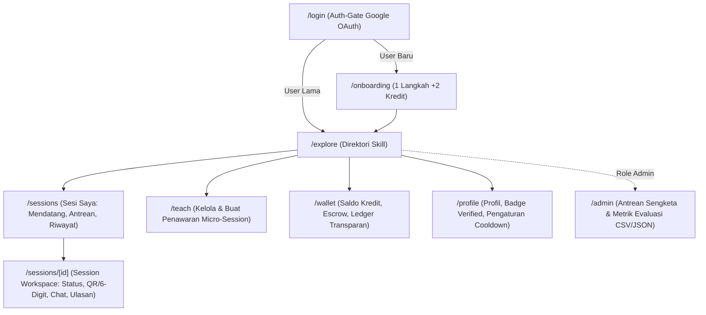

# Spesifikasi & Panduan UI/UX: SkillBarter MVP

Dokumen ini disusun berdasarkan [PRD_SkillBarter.md](file:///D:/Project/Hackathon/PRD_SkillBarter.md) dan seluruh keputusan desain yang telah disepakati untuk membangun MVP berbasis **Nuxt (TypeScript) + Tailwind CSS v4 + Nuxt UI v3**.

---

## 1. Arah Visual, Identitas & Design Tokens

* **Gaya Visual:** *Campus Trust Utility* (bersih, terstruktur, fokus pada bukti kehadiran dan keterbacaan tinggi untuk mahasiswa & juri kompetisi).
* **Three Dials (`antislop`):** `ENERGY 2` (seimbang, aksen terarah tanpa terasa steril) · `RHYTHM 2` (grid direktori konsisten diselingi layout split di `/onboarding` dan `/sessions/[id]`) · `MOTION 2` (transisi fungsional & *micro-feedback* terukur).
* **Mode Tema:** **Light Mode Only** (menjaga konsistensi kontras warna dan fokus QA MVP).
* **Identitas Logo:** **Geometric SVG Mark + Wordmark** (simbol geometris dua modul/panah saling bertaut melambangkan pertukaran 1:1 dalam `indigo-600` dan `teal-700`, dipadukan wordmark **SkillBarter** berfont *Plus Jakarta Sans SemiBold*).
* **Komponen Utama:** **Nuxt UI v3** (`UButton`, `UCard`, `UBadge`, `USlideover`, `UModal`, `UTable`, `UAlert`, `UAvatar`, `UTabs`, `UPinInput`).
* **Ikonografi:** **Phosphor Icons** (`@iconify-json/ph` / `i-ph-*`) — gaya `regular` untuk navigasi & aksi, gaya `duotone` khusus untuk penanda status penting (badge *Verified Peer Mentor*, *Escrow*). Tanpa ikon generik AI (`sparkles`, `magic`, dsb.).

### Palet Warna Semantik (Tailwind v4 / Nuxt UI `app.config.ts`, Terverifikasi WCAG AA)
| Peran | Token / Warna | Rasio Kontras di `#FFFFFF` | Penggunaan |
| :--- | :--- | :--- | :--- |
| **Primary** | `indigo-600` (`#4F46E5`) | `6.29:1` (PASS) | CTA utama (*Booking 1 Kredit*, *Simpan & Klaim*), link aktif, fokus input. |
| **Secondary / Trust** | `teal-700` (`#0F766E`) | `5.47:1` (PASS) | Badge **Verified Peer Mentor**, status check-in sukses, indikator kredit masuk (`+1`, `+2`). |
| **Surface / Background** | `slate-50` (`#F8FAFC`) | — | Latar belakang kanvas halaman agar kartu putih (`#FFFFFF`) terlihat tegas. |
| **Card & Border** | `white` + `slate-200` (`#E2E8F0`) | — | Border `1px` tipis dengan bayangan minimal (`shadow-xs`), hindari drop-shadow berat. |
| **Warning / Escrow** | `amber-700` (`#B45309`) | `5.02:1` (PASS) | Teks/badge kredit terkunci di *Escrow*, status *Hold Queue 48 Jam*, jeda sengketa 24 jam (latar `amber-50`). |
| **Danger / Penalty** | `rose-600` (`#E11D48`) | `4.70:1` (PASS) | Status *Cooldown* mengajar, laporan sengketa, peringatan batas batal `< 12 jam`. |
| **Tipografi** | **Plus Jakarta Sans** (Heading & UI) + **JetBrains Mono** (Kode Check-in 6-digit, angka kredit, timestamp) | — | Angka kredit dan kode check-in wajib memakai `tabular-nums` agar sejajar. |

---

## 2. Arsitektur Navigasi & Sitemap

### Pola Navigasi Responsif
* **Mobile (`< 768px`):**
  * **Top Bar Minimalis:** Logo *SkillBarter* di kiri + Pill **Saldo Kredit** (`2 Kredit • 1 Escrow`) di kanan yang bisa diklik menuju `/wallet`.
  * **Bottom Navigation Bar (Fixed, 4 Tab):**
    1. **Jelajah** (`/explore`) — ikon `i-ph-compass`
    2. **Sesi Saya** (`/sessions`) — ikon `i-ph-calendar-check` + dot statis (tanpa pulse) jika ada sesi hari ini / chat baru
    3. **Mengajar** (`/teach`) — ikon `i-ph-chalkboard-teacher`
    4. **Profil** (`/profile`) — ikon `i-ph-user`
* **Desktop (`>= 768px`):**
  * **Top Navigation Bar:** Logo di kiri, menu tengah (*Jelajah*, *Sesi Saya*, *Mengajar*, dan *Admin* jika `role = 'admin'`), lalu Pill Saldo Kredit (dapat diklik menuju `/wallet`) + Avatar User di kanan.

---

## 3. Spesifikasi Layar & Layout Per Halaman

### 3.1 `/login` — Auth-Gate Langsung
* **Tujuan:** Pintu masuk cepat tanpa gesekan OTP, langsung menjelaskan proposisi nilai untuk juri dan mahasiswa.
* **Layout:** Kartu terpusat (`max-w-md`) di atas latar `slate-50`.
  * Logo + Tagline: *"Learning Without Money, Teaching for Credits."*
  * 3 Poin *Trust* ringkas dengan ikon:
    1. *Micro-session 30 menit santai tanpa perlu bikin materi berat.*
    2. *Kredit aman di Escrow (1:1 adil, anti-minus).*
    3. *Ulasan 100% terverifikasi via Check-in QR.*
  * Tombol utama penuh lebar: `Masuk dengan Google` (`UButton` dengan ikon Google).

### 3.2 `/onboarding` — Split-Card "Beri & Terima" (1 Langkah)
* **Tujuan:** Menurunkan beban psikologis 23/30 responden yang ragu mengajar sekaligus memberi modal awal `2` kredit.
* **Layout:** 2 kartu bersebelahan di desktop (bertumpuk di mobile):
  * **Kartu Kiri — "Apa yang bisa kamu bantu?" (Skill Ajar):**
    * Sub-judul ramah: *"Mulai dari micro-session 30 menit. Santai, tanya-jawab, tanpa harus bikin slide."*
    * **Template Chips 1-Klik** (mengisi form otomatis): `Review Tugas / Portofolio (30m)`, `Q&A Dasar (30m)`, `Latihan Presentasi (30m)`, `Bedah Studi Kasus (30m)`.
    * Input judul singkat + pilih kategori.
  * **Kartu Kanan — "Apa yang ingin kamu pelajari?" (Skill Belajar):**
    * Multi-select/tag kategori & topik minat belajar.
    * Input opsional: **Kampus** & **Jurusan** (dengan microcopy: *"Opsional, bantu teman sekampus menemukanmu untuk sesi tatap muka"*).
  * **Footer Sticky / CTA Utama:**
    * Tombol `Simpan & Klaim +2 Kredit` (`indigo-600`).

### 3.3 `/explore` — Direktori Skill (*Compact Trust-First Card*)
* **Tujuan:** Memudahkan pencarian mentor sekaligus menonjolkan **Ulasan Terverifikasi** sebagai pembeda utama bagi juri.
* **Header Filter Bar:**
  * Search bar judul/topik + Filter Pills horizontal (*Semua*, *Micro 30m*, *Standar 60m*, *1-on-1*, *Grup 2-5*, *Tatap Muka*, *Online*, *Slot Tersedia*).
* **Grid Kartu Direktori (1 kolom mobile, 2–3 kolom desktop):**
  Setiap `UCard` hanya menampilkan **4 elemen inti** agar tidak penuh sesak:
  1. **Header:** Tag Kategori + Pill Durasi & Mode (`30m • 1-on-1 • Online` atau `60m • Grup 2/5 • Kampus`).
  2. **Judul Topik:** Maksimal 2 baris (mis. *"Bedah CV & Portfolio UI/UX untuk Magang"*).
  3. **Baris Trust Mentor:** Avatar + Nama + Jurusan/Kampus + Badge **`Verified Peer Mentor`** (`teal-700`, jika memenuhi syarat $\ge 3$ sesi, rating $\ge 4.5$, 0 penalti) + **`★ 4.9 (12 ulasan terverifikasi)`**.
  4. **Footer Aksi Kontekstual:**
     * Jika slot tersedia: Kiri `1 Kredit`, Kanan tombol `Booking Sesi`.
     * Jika slot penuh: Kiri `Slot Penuh`, Kanan tombol outline `Masuk Hold Queue (48j)`.
* **Interaksi Detail (`USlideover` di desktop / `UModal` penuh di mobile):**
  * Saat kartu diklik, terbuka panel detail berisi: deskripsi micro-session, **daftar slot hari & jam yang bisa dipilih**, info aturan pembatalan gratis ($\ge 12$ jam), serta **daftar lengkap Ulasan Terverifikasi** (lengkap dengan lencana *Verified Attendance*).
  * Tombol konfirmasi: `Kunci 1 Kredit di Escrow & Booking` (menampilkan sisa saldo setelah transaksi).

### 3.4 `/sessions` & `/sessions/[id]` — Sesi Saya & Session Workspace
* **Daftar Sesi (`/sessions`):**
  * Menggunakan `UTabs`: **Aktif & Mendatang**, **Hold Queue**, **Selesai & Dibatalkan**.
  * **Tab Hold Queue (Tampilan Tutor):** Menampilkan antrean masuk per penawaran skill beserta catatan preferensi waktu pembelajar. Tersedia tombol **`Terima & Jadwalkan`** (membuka modal untuk menetapkan tanggal/jam & lokasi/tautan Meet, lalu membuat `SESSIONS` dan membuka chat `/sessions/[id]`) serta tombol **`Tolak`** (otomatis *refund* 1 kredit).
  * Untuk sesi **Grup (2–5 orang)**, tampilkan indikator kuorum secara jelas: `Kuorum: 1/2 terkonfirmasi • Auto-batal jika < 2 pada T-2 jam`.
* **Session Workspace (`/sessions/[id]`):**
  * **Mobile:** *Sticky Action Header* di atas + *Full Chat* di bawah.
  * **Desktop:** *Split 2-Kolom* — Panel Info, Status & Check-in di kiri (`35%`), Ruang Chat di kanan (`65%`). Ruang chat hanya aktif setelah sesi berstatus `Confirmed`.
  * **State Machine pada Sticky Header / Panel Kiri:**
    1. `Queued` (untuk Pembelajar sebelum dijadwalkan): Banner amber *"Menunggu konfirmasi pengajar. 1 kredit terkunci di escrow (auto-refund dalam XX jam)."* + tombol `Batalkan & Refund`.
    2. `Confirmed` (sebelum jam mulai): Info jadwal, lokasi/tautan Meet + tombol `Batal Gratis` (hijau jika $\ge 12$ jam, atau peringatan merah *"Batal sekarang menghanguskan 1 kredit"* jika $< 12$ jam).
    3. `Waktu Sesi Tiba` (Window Check-in **`T - 10 menit` s.d. `T + 15 menit`**):
       * **Tampilan Tutor:** Tombol `Buat Kode Check-in` $\rightarrow$ memunculkan **Kode 6-Digit besar (`JetBrains Mono`) + QR Code** + timer batas check-in. Jika lewat `T + 15 menit` kode tidak dibuat, *lazy-check* otomatis memicu `TutorPenalized` (*refund* 100% + *cooldown* 1/3/7 hari).
       * **Tampilan Learner:** `UPinInput` 6-digit + tombol `Scan QR` (menggunakan kamera browser) untuk memvalidasi kehadiran. Jika kode sudah dibuat tetapi tutor tidak hadir, tersedia tautan `Laporkan Masalah / Sengketa`.
    4. `CheckedIn` (Jeda Sengketa 24 Jam per `booking_id`):
       * Banner teal *"Kehadiran terverifikasi! Kredit cair dalam 23j 59m."*
       * **Ulasan Terverifikasi Terbuka:** Kartu form rating bintang (1–5) + komentar singkat muncul otomatis untuk Learner.
       * Tautan kecil di bawah: `Laporkan Masalah / Sengketa` (membuka modal laporan ke Admin untuk `booking_id` terkait).
* **Ruang Chat Terikat Sesi:**
  * Indikator kecil *"Sinkronisasi otomatis"* (polling 3–5 detik).
  * Auto-link detection untuk URL Google Meet / Zoom / Discord dan format kartu pratinjau lokasi kampus. Tidak ada tombol upload file/gambar sesuai batasan MVP.

### 3.5 `/teach`, `/wallet`, `/profile`, & `/admin`
* **`/teach` (Kelola Skill Mengajar):**
  * Jika user sedang kena **Cooldown** (FR-6.3), tampilkan `UAlert` merah di paling atas: *"Mode mengajar dijeda hingga [Tanggal/Jam] karena no-show sebelumnya."* dan nonaktifkan tombol buat sesi baru.
  * Jika ada permintaan **Hold Queue** yang menunggu konfirmasi, tampilkan banner pengingat dengan tautan langsung ke tab Hold Queue di `/sessions`.
  * Menampilkan progres menuju badge **`Verified Peer Mentor`**: Progress bar `2/3 Sesi Selesai`, `Rating 4.8/4.5`, `0 Penalti`.
* **`/wallet` (Transparansi Kredit & Escrow):**
  * 2 Kartu ringkas di atas: **Saldo Tersedia** (bisa dipakai booking) & **Terkunci di Escrow** (sedang dipakai di booking/hold queue).
  * Tabel riwayat `CREDIT_LEDGER` kronologis (`+2 Modal Awal`, `-1 Escrow Booking`, `+1 Pencairan Sesi`, `+1 Refund Hold Queue Expired`) agar juri & pengguna yakin tidak ada kredit hilang/minus.
* **`/profile` (Profil, Reputasi & Akses Mobile):**
  * Kartu identitas pengguna: Avatar, Nama, serta form edit cepat **Kampus** & **Jurusan**.
  * Status badge **`Verified Peer Mentor`** beserta progres syaratnya, dan banner status **Cooldown** (jika sedang aktif).
  * Ringkasan daftar **Skill Ajar** & **Skill Belajar** dengan tautan edit.
  * Kartu pintasan navigasi (krusial untuk pengguna mobile karena tidak ada di Bottom Nav): **Dompet Kredit (`/wallet`)**, **Dashboard Admin (`/admin`)** (hanya tampil jika `role = 'admin'`), serta tombol **Keluar**.
* **`/admin` (Khusus Tim Penyelenggara & Demo Juri):**
  * **Tab 1 — Metrik Evaluasi v1:** 4 KPI Card (Total Sesi Selesai, Rasio 30m vs 60m, Total Kredit Berputar, Rata-rata Rating Terverifikasi) + tombol **`Export CSV`** dan **`Export JSON`** di pojok kanan atas.
  * **Tab 2 — Antrean Sengketa:** Tabel laporan `REPORTS` (per `booking_id`) dengan tombol aksi langsung: `Refund Pembelajar`, `Cairkan ke Pengajar`, atau `Terapkan Cooldown Tutor`.
  * **Panel Simulasi Demo Juri:** Tombol *fast-forward* waktu pada data uji coba (memicu pencairan jeda sengketa 24 jam, kedaluwarsa *Hold Queue* 48 jam, dan evaluasi kuorum `T - 2 jam`) agar seluruh siklus hidup kredit dapat didemokan secara *live* di depan juri.

---

## 4. Microcopy Anti-Ragu (Untuk Pengajar Pemula)

Gunakan bahasa Indonesia yang suportif, konkret, dan bebas karakter em dash (`—`) pada teks UI agar 23/30 mahasiswa yang ragu mengajar merasa aman:
* **Saat membuat listing 30 menit:** *"Tidak perlu silabus panjang. Cukup bantu jawab pertanyaan atau review tugas teman selama 30 menit."*
* **Saat menerima booking:** *"Pastikan kamu hadir tepat waktu. Jika berhalangan, batalkan minimal 12 jam sebelumnya agar terhindar dari cooldown."*
* **Saat hendak mengirim ulasan (untuk learner):** *"Ulasanmu hanya bisa dikirim karena kehadiranmu sudah terverifikasi lewat Check-in."*

---

## 5. Panduan Animasi, Daftar Ikon & Standar Aksesibilitas (`antislop`)

### Aturan Gerak (`MOTION 2`)
Seluruh transisi non-esensial wajib dibungkus `@media (prefers-reduced-motion: no-preference)`. Dilarang menggunakan *fade-up* massal, animasi melayang (*floating*), atau dot status berkedip terus-menerus (`animate-pulse` hanya untuk *skeleton loading* sementara).
1. **Slideover & Modal (`150-200ms ease-out`):** Pembukaan panel detail mentor (`/explore`) dan modal jadwal *Hold Queue* (`/sessions`) untuk menjaga konteks posisi pengguna.
2. **Feedback Saldo & Escrow (`tabular-nums`):** Highlight singkat satu kali pada pill saldo atau baris terbaru `CREDIT_LEDGER` saat terjadi penguncian escrow (`-1`) atau pencairan (`+1`/`+2`).
3. **Transisi Check-in Terverifikasi:** Transisi state mulus dari input PIN 6-digit / QR menuju banner *Kehadiran Terverifikasi* dan kemunculan form ulasan.
4. **Hover & Active States (`120ms`):** Perubahan border/background/tekanan ringan pada tombol, tab, dan kartu (tidak hanya mengandalkan perubahan warna).

### Pemetaan Ikon Fungsional (Phosphor Icons)
* **Navigasi:** `i-ph-compass` (Jelajah), `i-ph-calendar-check` (Sesi Saya), `i-ph-chalkboard-teacher` (Mengajar), `i-ph-user` (Profil), `i-ph-wallet` (Dompet), `i-ph-shield-check` (Admin).
* **Status & Aksi:** `i-ph-seal-check-duotone` (Verified Peer Mentor), `i-ph-lock-simple-duotone` (Escrow Terkunci), `i-ph-clock` (Hold Queue / Timer), `i-ph-qr-code` (Check-in QR), `i-ph-video-camera` (Online Meet), `i-ph-map-pin` (Tatap Muka), `i-ph-warning-circle` (Cooldown / Sengketa), `i-ph-chat-circle-text` (Chat Sesi), `i-ph-download-simple` (Export CSV/JSON).

### Standar Aksesibilitas & Kualitas UI (`antislop-human`)
* **Affordance & Keyboard:** Semua kontrol interaktif aktif wajib memakai elemen semantik native (`<button>`, `<a href>`), menampilkan `cursor: pointer` di base CSS, target sentuh minimal `44px` di mobile, dan `:focus-visible` dengan kontras minimal `3:1`.
* **Nama Aksesibel:** Setiap tombol ikon tanpa teks wajib memiliki `aria-label`, dan ikon di dalamnya diberi `aria-hidden="true"`. Setiap field form wajib memiliki `<label>` yang terlihat.
* **3 State Wajib:** Setiap tampilan data (`/explore`, `/sessions`, `/wallet`, `/admin`) wajib memiliki *Empty state* (menjelaskan sebab + aksi berikutnya), *Loading state* (menyebutkan apa yang sedang dimuat), dan *Error state* (menjelaskan kegagalan + tombol coba lagi).
