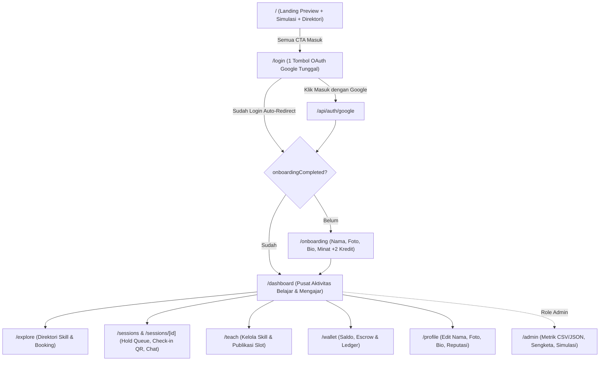

# Spesifikasi & Aturan Desain UI/UX v2.0: SkillBarter

Dokumen ini menetapkan aturan desain resmi untuk **SkillBarter** (berbasis **Nuxt 4 compatibility + TypeScript + Tailwind CSS v4 + Nuxt UI v3**). Seluruh halaman dan komponen wajib mematuhi aturan sistem **Single-Hue Primary Blue + Stroke Hierarchy** tanpa pencampuran warna aksen.

---

## 1. Prinsip Inti: Single-Hue Primary + Stroke Hierarchy

* **Aturan Tanpa Campuran Warna (Zero Color Mixing):**
  * Seluruh antarmuka hanya menggunakan **1 warna primer (`blue`)** bersama **skala netral (`white` + `slate`)**.
  * **Dilarang keras** mencampur warna aksen lain seperti `indigo`, `teal`, `sky`, `amber`, `emerald`, `stone`, latar krem `#F7F5F0`, atau gradien gelap multi-warna pada komponen UI.
  * Warna semantik tambahan hanya **`rose-600` (`#E11D48`)** dan **dibatasi ketat** untuk kondisi galat (*error alert*), penalti *cooldown*, peringatan hangus `< 12 jam`, dan aksi destruktif (`Keluar`, `Tolak`).
* **Hierarki Berbasis Stroke (Garis) & Kontras Permukaan:**
  Alih-alih membedakan elemen dengan banyak warna berbeda, hierarki visual dibangun menggunakan **ketebalan stroke (`border`, `border-2`, `border-l-4`)**, **bobot tipografi**, dan **perbedaan isi solid vs outline**.
* **Mode Tema:** **Light Mode Only** (kanvas `slate-50` `#F8FAFC` + kartu putih `#FFFFFF`) demi keterbacaan maksimal dan konsistensi kontras WCAG AA.
* **Identitas Logo:** Geometric SVG Mark dua panah pertukaran 1:1 dalam stroke `#2563EB` dan `#1D4ED8` di dalam kotak ber-stroke `#BFDBFE` (`fill #EFF6FF`), dipadukan wordmark **Skill** (`slate-900`) + **Barter** (`blue-600`).
* **Ikonografi:** **Phosphor Icons** (`@iconify-json/ph` / `i-ph-*`) gaya `regular` untuk navigasi/aksi dan `duotone` untuk indikator status terverifikasi (`i-ph-seal-check-duotone`).

---

## 2. Token Warna & Rasio Kontras (WCAG AA)

Konfigurasi Nuxt UI (`app/app.config.ts`): `primary: 'blue'`, `secondary: 'blue'`, `warning: 'blue'`, `error: 'rose'`, `neutral: 'slate'`.

| Peran Desain | Token Tailwind / Hex | Rasio Kontras | Penggunaan Wajib |
| :--- | :--- | :--- | :--- |
| **Primary Solid** | `bg-blue-600` (`#2563EB`) + `text-white` | `5.17:1` (PASS) | CTA utama (hanya 1 tombol aksi dominan per area), tab aktif, indikator progres bar. |
| **Primary Hover** | `bg-blue-700` (`#1D4ED8`) + `text-white` | `6.70:1` (PASS) | Status hover CTA utama, teks link primer (`text-blue-700`). |
| **Primary Stroke (Tegas)** | `border-2 border-blue-600` / `border-l-4 border-l-blue-600` | `5.17:1` (PASS) | Kartu Sorotan (*Spotlight*), Banner Identitas Profil, Kartu Reputasi Mentor, baris aktif direktori, tombol outline sekunder. |
| **Primary Subtle Tint** | `bg-blue-50` (`#EFF6FF`) + `border-blue-200` (`#BFDBFE`) | `> 6.0:1` (dgn `blue-700`) | Badge `Verified UKSW`, tag `Slot Tersedia`, kotak kutipan ulasan terverifikasi, fokus navigasi aktif. |
| **Canvas Halaman** | `bg-slate-50` (`#F8FAFC`) | — | Latar belakang halaman agar kartu putih `#FFFFFF` tegas tanpa bayangan berat. |
| **Surface Kartu & Stroke** | `bg-white` + `border-slate-200` (`#E2E8F0`) | — | Kartu standar, panel form, daftar direktori, pembatas seksi (`divide-slate-200`). |
| **Tipografi Utama** | `text-slate-900` (`#0F172A`) | `16.4:1` (PASS) | Judul halaman, judul skill, nama mentor, angka metrik utama. |
| **Tipografi Sekunder** | `text-slate-600` (`#475569`) | `7.5:1` (PASS) | Deskripsi paragraf, teks instruksi, isi ulasan. |
| **Tipografi Tersier** | `text-slate-500` (`#64748B`) | `4.7:1` (PASS) | Metadata kategori, durasi, kampus, timestamp. Hindari `slate-400` untuk teks informasi. |
| **Destructive / Error** | `rose-600` (`#E11D48`) / `rose-50` + `border-rose-200` | `4.70:1` (PASS) | Hanya untuk error API, status Cooldown, peringatan batal `< 12 jam`, tombol Keluar/Tolak. |

---

## 3. Aturan Hierarki Visual 3-Lapis

Setiap blok informasi (seperti Direktori Mentor di `/` dan `/explore`, Rekomendasi di `/dashboard`, dan Kartu Sesi di `/sessions`) wajib mengikuti 3 tingkat hierarki:

1. **Lapis 1 — Fokus Utama (Primary):**
   * Judul penawaran/halaman (`font-bold text-slate-900`) selalu berada di posisi paling atas tanpa terhalang tumpukan pil warna.
   * Maksimal 1 penanda status ringkas sejajar judul (`Slot Tersedia` memakai `bg-blue-50 border-blue-200 text-blue-700`, sedangkan `Hold Queue` memakai stroke netral `bg-white border-slate-300 text-slate-600`).
   * Kartu sorotan utama menggunakan **`bg-white border-2 border-blue-600`** agar langsung menjadi jangkar visual tanpa memutus ritme terang halaman.
2. **Lapis 2 — Identitas & Kredensial (Secondary):**
   * Avatar/inisial (`bg-blue-50 border border-blue-200 text-blue-700`) + Nama Mentor (`font-semibold text-slate-800`).
   * Lencana kepercayaan seragam dalam keluarga biru + stroke:
     * **`Verified UKSW`:** `bg-blue-50 text-blue-700 border border-blue-200` (otomatis untuk email `@student.uksw.edu` dan `@uksw.edu`).
     * **`Verified Peer Mentor`:** `bg-white text-blue-700 border border-blue-600`.
3. **Lapis 3 — Metadata & Aksi Pendukung (Tertiary):**
   * Kategori, durasi, mode, kampus/jurusan, dan rating digabung dalam satu baris tenang (`text-xs text-slate-500 tabular-nums`) memakai pemisah titik tengah (`·`) yang hanya tampil jika elemennya ada (tanpa titik gantung).
   * Tombol pratinjau/sekunder memakai stroke (`border-slate-200 hover:border-blue-600 hover:text-blue-700`), dan tombol aksi utama memakai solid `bg-blue-600 text-white`.

---

## 4. Tipografi & Sistem Angka

* **Heading & UI:** `Plus Jakarta Sans` (`--font-sans`) dengan `text-wrap: balance` untuk `h1`/`h2`.
* **Aksen Editorial Hero:** `Instrument Serif` italic (`--font-serif`) khusus untuk 1 frasa penekanan pada headline utama (`tanpa uang,`, `kredit belajar,`) dalam `text-blue-600`.
* **Angka & Kode Teknis:** `JetBrains Mono` (`--font-mono`) + `tabular-nums` wajib digunakan pada saldo kredit, saldo escrow, kode check-in 6 digit, persentase progres, dan kode langkah (`01`, `02`, `03`).

---

## 5. Arsitektur Navigasi & Aturan Alur Login Tunggal

### Aturan Alur Autentikasi
1. **Satu Tombol OAuth Google Tunggal:** Satu-satunya tautan langsung `<a href="/api/auth/google">` berada di halaman `/login`.
2. **Routing Seragam dari Halaman Publik:** Seluruh tombol masuk di halaman `/` (Header `Masuk`, Hero `Mulai & Masuk`, Spotlight `Masuk & Booking`, dan Direktori) mengarah ke `/login` saat belum login, atau langsung ke `/dashboard` / `/explore` saat sudah login.
3. **Hydration Sesi Tanpa Stuck:** Middleware global (`app/middleware/auth.global.ts`) selalu memanggil `fetchSession()` ketika status `loggedIn` belum aktif, termasuk pada `/` dan `/login`, sehingga pengguna yang sudah login langsung dialihkan dari `/login` ke `/dashboard` atau `/onboarding`.

### Navigasi Aplikasi Terautentikasi (`app/layouts/default.vue`)
* **Desktop (`>= 768px`):** Top bar putih ber-stroke `border-b border-slate-200` berisi Logo di kiri, menu tengah (*Dashboard*, *Jelajah*, *Sesi Saya*, *Mengajar*, dan *Admin* khusus admin) dengan garis aktif bawah biru (`box-shadow: inset 0 -2px 0 0 #2563EB`), serta pill Saldo Kredit ber-stroke biru + Avatar Profil di kanan.
* **Mobile (`< 768px`):** Top bar minimalis (Logo + Pill Saldo Kredit) dan Bottom Navigation 5 tab (*Beranda*, *Jelajah*, *Sesi*, *Mengajar*, *Profil*) dengan garis aktif atas biru (`#2563EB`).

---

## 6. Spesifikasi Layout Halaman Utama

1. **`/` (Landing Preview):**
   * Hero 2-kolom: proposisi nilai + badge `Verified UKSW` + CTA `Mulai & Masuk` (`/login`) + statistik nyata dari database di kiri, dan `CreditFlowSimulator` (SVG stroke biru murni dengan 3 skenario: 1-on-1, Grup Cap 2, Refund 100%) di kanan.
   * Seksi mekanisme 3-poin (daftar ber-garis `divide-slate-200`) + `CheckinPreviewWidget` interaktif.
   * Seksi Master-Detail Direktori: Kartu Spotlight (`border-2 border-blue-600`) di kiri yang tersinkronisasi dengan daftar 3-lapis penawaran mentor di kanan.
2. **`/login` (Gerbang Masuk Tunggal):**
   * Kolom kiri: 3 pilar nilai interaktif + strip pratinjau ber-stroke biru (`border-2 border-blue-600`).
   * Kolom kanan: kartu masuk bersih dengan simulator status domain (`@student.uksw.edu` vs `Gmail Umum`) dan 1 tombol `Masuk dengan Google` berstatus umpan balik `Mengalihkan ke Google…`.
3. **`/onboarding` (Identitas Kustom + 2 Kredit Awal):**
   * Form identitas (upload & hapus foto profil 256×256 WebP, ubah Nama Tampilan dari default Google, Bio singkat, Kampus, Jurusan) diikuti 2 kartu paralel (Minat Belajar + Draf Topik Mengajar 30m) menuju `/dashboard`.
4. **`/dashboard` (Pusat Aktivitas):**
   * Switcher `Mode Belajar` / `Mode Mengajar`, Kartu Rasio Dompet Kredit (bar biru solid vs biru lembut `blue-200`), Kartu Reputasi Peer Mentor (`border-2 border-blue-600`), daftar rekomendasi mentor ber-filter, agenda sesi terdekat, dan aktivitas ledger.
5. **`/explore`, `/sessions`, `/sessions/[id]`, `/teach`, `/wallet`, `/profile`, `/admin`:**
   * Seluruhnya menggunakan kartu putih `border-slate-200`, fokus/pilihan aktif `border-blue-600`, tombol primer `bg-blue-600`, dan tombol sekunder `border-blue-600 bg-white text-blue-700`.

---

## 7. Standar Gerak (`MOTION 2`) & Aksesibilitas

* **Transisi Compositor-Only:** Gunakan hanya `opacity` dan `transform` (`page-fade` 160ms, `panel-slide` 180ms, `verified-reveal` 240ms) serta hormati `@media (prefers-reduced-motion: reduce)`.
* **Interaksi & Target Sentuh:** Semua kontrol aktif memakai elemen native (`<button>`, `<a href>`), `cursor: pointer`, target sentuh minimal `40px-48px`, dan ring `:focus-visible` `2px solid #2563EB`.
* **Tiga State Data Wajib:** Setiap halaman data wajib menampilkan state *Loading* (`aria-busy="true"`), *Error* (`UAlert color="error"` + tombol coba lagi), dan *Empty* (penjelasan + aksi lanjut).
* **Microcopy:** Bahasa Indonesia yang jelas, ramah bagi pengajar pemula, dan tanpa tanda em dash (`—`) di teks antarmuka.
