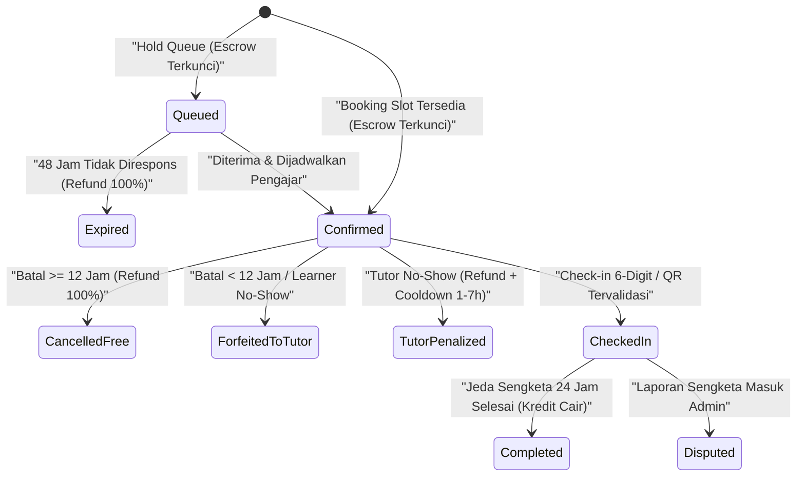
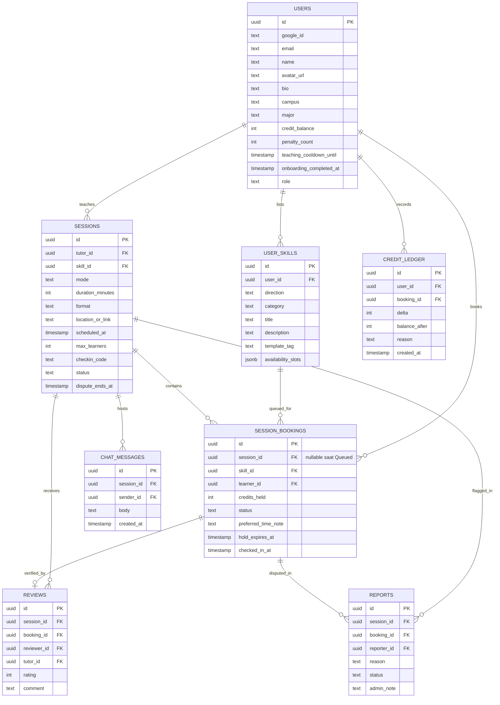

# Product Requirements Document (PRD) v2.0: SkillBarter MVP

> **Learning Without Money, Teaching for Credits**  
> Dokumen ini merupakan spesifikasi produk dan teknis terbaru MVP **SkillBarter** untuk **Case 1: Smarter Campus and Learning** oleh tim **pecut agen**, mencakup arsitektur ekonomi kredit, verifikasi kehadiran QR, verifikasi identitas kampus UKSW, personalisasi profil, dan aturan antarmuka **Single-Hue Primary Blue + Stroke** ([DESIGN.md](file:///D:/Project/Hackathon/DESIGN.md)).

---

## 1. Ringkasan Eksekutif & Konteks Kompetisi

| Atribut | Detail |
| :--- | :--- |
| **Nama Produk** | SkillBarter: Learning Without Money, Teaching for Credits |
| **Tim** | pecut agen (Teofilus Tri Adinugraha Moelyono, Archyeza Gaciyama Feodora, Cynthia Elena Gunadi, Efraim Bias Adisya) |
| **Kasus Kompetisi** | Case 1: Smarter Campus and Learning |
| **Pembeda Utama** | Ekonomi kredit 1:1 berbasis *escrow* anti-minus, ulasan 100% terverifikasi via Check-in QR/6-digit (*attendance-gated*), micro-session 30 menit berbasis template, serta verifikasi otomatis email kampus UKSW (`Verified UKSW`). |
| **Target MVP** | Aplikasi web fullstack siap uji dan demo yang cepat dimuat, bebas hambatan masuk, dan memiliki alat simulasi waktu langsung untuk juri. |

### Masalah & Bukti Survei (30 Mahasiswa)
1. **Kebutuhan belajar lintas bidang tinggi:** Rata-rata **4,3 / 5**.
2. **Kesulitan menemukan teman yang bisa mengajari:** Rata-rata **3,4 / 5**.
3. **Kesenjangan kesiapan mengajar:** Dari 30 responden, hanya **6** yang bersedia mengajar tanpa syarat, sedangkan **17 ragu-ragu** dan **6 bersedia bersyarat**.

> [!IMPORTANT]
> Untuk mengatasi keraguan 23/30 mahasiswa yang belum percaya diri mengajar, pengguna baru langsung diarahkan ke **Dashboard Belajar** dengan modal **+2 kredit awal** (tidak dipaksa langsung membuka kelas), sementara penawaran mengajar disimpan sebagai draf **micro-session 30 menit berbasis template**.

---

## 2. Target Pengguna (Personas)

1. **Pembelajar (*Learner*):** Mahasiswa yang ingin mempelajari skill praktis lintas jurusan tanpa uang, melihat pratinjau mentor nyata sebelum mendaftar, dan memilih mentor berdasarkan ulasan terverifikasi check-in.
2. **Pengajar Rekan (*Peer Tutor / Mentor*):** Mahasiswa yang berbagi keterampilan praktis lewat micro-session 30 menit atau grup 60 menit untuk memperoleh kredit belajar dan reputasi (`Verified Peer Mentor` & `Verified UKSW`).
3. **Admin / Juri Demo:** Memantau metrik evaluasi v1 (ekspor CSV/JSON), menyelesaikan antrean sengketa per `booking_id`, dan menjalankan simulasi *fast-forward* siklus kredit secara langsung.

---

## 3. Arsitektur & Stack Teknologi

| Lapisan | Teknologi | Catatan Implementasi |
| :--- | :--- | :--- |
| **Framework Fullstack** | **Nuxt 3 (compat v4) + TypeScript** | SSR/CSR + Nitro API routes dalam satu repositori. |
| **UI & Styling** | **Tailwind CSS v4 + Nuxt UI v3 + Phosphor Icons** | Sistem **Single-Hue Primary Blue + Stroke** (`#2563EB`, `#FFFFFF`, `slate-*`, error-only `rose-600`). |
| **Database** | **PostgreSQL (Neon)** | Transaksi ACID untuk saldo kredit, *escrow*, dan ledger atomik. |
| **ORM** | **Drizzle ORM** | Skema *type-safe* di `server/database/schema.ts`. |
| **Autentikasi & Sesi** | **Google OAuth (`nuxt-auth-utils`)** | 1 pintu masuk di `/login` dengan cookie sesi terenkripsi (`NUXT_SESSION_PASSWORD`). |
| **Foto Profil** | **Kompresi WebP Klien (256×256)** | Crop 1:1 di browser (`app/utils/avatarUpload.ts`), disimpan sebagai DataURL tervalidasi (`avatarUrlSchema`) tanpa ketergantungan storage eksternal. |
| **Pertemuan & Chat** | **Link Eksternal / Tatap Muka + Polling (3–5 dtk)** | Auto-link Google Meet/Zoom/Discord di ruang chat khusus sesi `Confirmed`. |

---

## 4. Alur Inti Pengguna (*Core User Flow*)

```mermaid
flowchart LR
    Landing["/ Pratinjau Publik & Simulasi"] --> Login["/login (1 Tombol Google OAuth)"]
    Login --> Check{"User Baru?"}
    Check -- Ya --> Onb["/onboarding (Nama Kustom, Foto, Bio, Minat +2 Kredit)"]
    Check -- Tidak --> Dash["/dashboard (Mode Belajar & Mengajar)"]
    Onb --> Dash
    Dash --> Explore["/explore (Direktori Filterable)"]
    Explore --> Slot{"Slot Tersedia?"}
    Slot -- Ya --> Book["Booking Langsung (Kunci 1 Kredit Escrow)"]
    Slot -- Penuh --> Queue["Hold Queue (Escrow 48 Jam)"]
    Queue -- Diterima Tutor --> Book
    Book --> Chat["Workspace /sessions/[id] (Chat & Check-in 6-Digit/QR)"]
    Chat --> Review["Ulasan Terverifikasi Terbuka & Jeda Sengketa 24 Jam"]
    Review --> Payout["Pencairan Kredit ke Saldo Pengajar"]
```

---

## 5. Spesifikasi Fungsional Rinci

### 5.0 Halaman Pratinjau Publik (`/`)
- **FR-0.1 Pratinjau Tanpa Login:** Pengunjung dapat langsung melihat ringkasan nilai produk, angka statistik nyata dari database (skill aktif, sesi selesai, ulasan terverifikasi), dan daftar pratinjau mentor aktif sebelum masuk.
- **FR-0.2 Simulasi Interaktif Ekonomi Kredit & Check-in:**
  - `CreditFlowSimulator`: simulasi interaktif 3 skenario (*1-on-1*, *Grup Cap 2*, dan *Refund 100% / Tutor No-Show*) yang dapat diputar, dijeda, dan diklik per langkah.
  - `CheckinPreviewWidget`: simulasi alur pembuatan kode check-in 6 digit/QR hingga terbukanya form ulasan terverifikasi.
- **FR-0.3 Direktori Master-Detail Publik:** Pengunjung dapat memfilter kategori pratinjau mentor dan memilih penawaran untuk melihat sorotan detail serta ulasan terverifikasi.

### 5.1 Autentikasi Tunggal, Badge Verified UKSW & Onboarding Kustom
- **FR-1.1 Satu Pintu Login (`/login`):** Hanya tersedia **1 tombol OAuth Google** di halaman `/login`. Seluruh tombol masuk lain di `/` me-route ke `/login`. Pengguna yang sudah memiliki sesi aktif otomatis diarahkan dari `/login` ke `/dashboard` (atau `/onboarding`).
- **FR-1.2 Verifikasi Otomatis Kampus UKSW (`Verified UKSW`):** Akun yang masuk dengan domain email `@student.uksw.edu` atau `@uksw.edu` otomatis ditandai `isVerifiedUksw = true`, memperoleh badge **Verified UKSW** di profil, dashboard, dan direktori, serta prefill kampus `Universitas Kristen Satya Wacana (UKSW)`. Akun Gmail umum tetap dapat mendaftar dan memakai seluruh fitur.
- **FR-1.3 Personalisasi Identitas di Onboarding (`/onboarding`) & Profil (`/profile`):**
  - Pengguna dapat mengubah **Nama Tampilan** (tidak terikat nama bawaan Google), mengunggah atau menghapus **Foto Profil** (PNG/JPEG/WebP maks 5 MB, dikompres otomatis ke WebP 256×256), serta mengisi **Bio Singkat**, **Kampus**, dan **Jurusan**.
  - Memilih minimal 1 minat belajar dan 1 draf topik mengajar 30 menit (tersedia chip cepat & template).
  - Menyelesaikan onboarding memberikan **+2 kredit modal awal** dan mengarahkan langsung ke `/dashboard`.

### 5.2 Dashboard Aktivitas (`/dashboard`)
- **FR-2.1 Pusat Aktivitas 2-Mode:** Pengguna dapat beralih antara **Mode Belajar** dan **Mode Mengajar**.
- **FR-2.2 Ringkasan Dompet & Reputasi:** Menampilkan rasio saldo tersedia vs escrow secara visual, progres menuju badge `Verified Peer Mentor`, rekomendasi mentor yang cocok dengan minat belajar, agenda sesi terdekat, peringatan Hold Queue masuk, dan riwayat ledger terbaru.

### 5.3 Listing Skill, Micro-Session & Mengajar (`/teach`)
- **FR-3.1 Penawaran Sesi:** Pengajar dapat menambahkan topik skill dan mempublikasikan slot jadwal:
  - **Durasi:** *Micro-session* **30 menit** atau standar **60 menit**.
  - **Mode:** **1-on-1** atau **Grup (2–5 peserta, khusus 60 menit)**.
  - **Format:** Online (tautan Meet/Zoom/Discord) atau Tatap Muka (lokasi kampus).
- **FR-3.2 Pengaman Cooldown:** Jika pengajar sedang dalam masa *cooldown*, formulir publikasi slot dinonaktifkan dan banner status ditampilkan jelas.

### 5.4 Direktori Pencarian, Booking & Hold Queue (`/explore`, `/sessions`)
- **FR-4.1 Filter Direktori:** Pencarian teks (judul/topik/mentor), filter kategori, durasi (`30m`/`60m`), tipe (`1-on-1`/`Grup`), format (`Online`/`Kampus`), dan filter slot tersedia.
- **FR-4.2 Booking Langsung & Hold Queue 48 Jam:**
  - Slot tersedia: memotong `1` kredit ke *escrow* dan langsung membuat booking `Confirmed`.
  - Slot penuh: pembelajar dapat masuk **Hold Queue** pada `skill_id` (`session_id = NULL`) dengan catatan waktu pilihan dan penguncian `1` kredit di *escrow*.
  - Pengajar dapat **Terima & Jadwalkan** (membuat sesi dan membuka chat) atau **Tolak** (refund 100%). Jika tidak direspons dalam **48 jam**, *lazy-check* otomatis mengembalikan kredit 100%.

### 5.5 Ekonomi Kredit (Bilangan Bulat & Anti-Minus)

| Jenis Sesi | Durasi | Biaya Pembelajar | Pendapatan Pengajar | Aturan Ekonomi |
| :--- | :--- | :--- | :--- | :--- |
| **1-on-1 (Micro / Standar)** | 30 atau 60 menit | `1` kredit | `1` kredit | Pertukaran 1:1 langsung tanpa biaya uang. |
| **Grup (2–5 Pembelajar)** | 60 menit | `1` kredit / orang | Maksimal flat **`2` kredit** | Kuorum minimal **2 peserta** pada `T - 2 jam`; mencegah inflasi kredit. |

- **FR-5.1 Transaksi Atomik & Ledger (`/wallet`):** Semua mutasi `credit_balance` berjalan atomik di PostgreSQL (`balance >= 0`) dan dicatat kronologis pada `credit_ledger`.
- **FR-5.2 Pelacakan Parsial Grup:** Check-in, ulasan, pembatalan, dan sengketa dilacak per `booking_id` sehingga sengketa 1 peserta tidak menahan pencairan peserta lain yang sah.

### 5.6 Verifikasi Kehadiran, Ulasan, Pembatalan & Cooldown (`/sessions/[id]`)
- **FR-6.1 Window Check-in (`T - 10m` s.d. `T + 15m`):** Pengajar membuat kode 6 digit + QR; pembelajar mengetik kode atau memindai QR via kamera.
- **FR-6.2 Ulasan Terverifikasi (*Attendance-Gated*):** Form rating (1–5) dan komentar hanya muncul setelah status booking `CheckedIn` atau `Completed`.
- **FR-6.3 Jeda Sengketa 24 Jam:** Setelah check-in, kredit menunggu 24 jam sebelum cair otomatis ke pengajar agar pembelajar dapat melapor jika terjadi pelanggaran.
- **FR-6.4 Badge `Verified Peer Mentor`:** Otomatis aktif bila pengajar memiliki $\ge 3$ sesi mengajar selesai, rating rata-rata $\ge 4,5$, dan `0` penalti aktif.
- **FR-6.5 Pembatalan & Penalti Cooldown:**
  - Batal $\ge 12$ jam sebelum sesi: refund 100% gratis.
  - Batal $< 12$ jam atau Learner No-Show: 1 kredit diserahkan ke pengajar.
  - Tutor No-Show (lewat `T + 15m` tanpa kode check-in): refund 100% ke pembelajar + *cooldown* mengajar bertingkat **1 hari $\rightarrow$ 3 hari $\rightarrow$ 7 hari** (maksimal, tanpa saldo minus).

### 5.7 Ruang Chat Terikat Sesi & Admin (`/admin`)
- **FR-7.1 Chat Sesi Otomatis:** Ruang chat aktif hanya untuk peserta sesi `Confirmed` ke atas dengan deteksi tautan otomatis (tanpa DM bebas dan tanpa upload file).
- **FR-7.2 Dashboard Admin & Simulasi Juri:** Metrik evaluasi v1 + ekspor CSV/JSON, penyelesaian laporan sengketa (`Refund Pembelajar`, `Cairkan ke Pengajar`, `Terapkan Cooldown Tutor`), dan tombol *fast-forward* waktu untuk demo langsung.

---

## 6. Model Data Konseptual (PostgreSQL + Drizzle ORM)

---

## 7. Kebutuhan Non-Fungsional & Batasan MVP

### Non-Functional Requirements
1. **Integritas Kredit:** Saldo kredit tidak pernah negatif; setiap perubahan tercatat atomik di `credit_ledger`.
2. **Konsistensi Visual & Aksesibilitas:** Seluruh UI wajib mematuhi sistem **Single-Hue Primary Blue + Stroke** dan kontras WCAG AA pada [DESIGN.md](file:///D:/Project/Hackathon/DESIGN.md).
3. **Performa & Responsivitas:** Pengambilan data halaman terautentikasi dan publik bersifat *non-blocking* dengan state *Loading*, *Error*, dan *Empty* yang jelas di mobile maupun desktop.
4. **Otomasi Berbasis Waktu:** Evaluasi kedaluwarsa Hold Queue (48 jam), kuorum grup (`T - 2 jam`), deteksi Tutor No-Show (`T + 15m`), dan pencairan pasca-sengketa (24 jam) berjalan otomatis lewat *lazy-check* API.

### Di Luar Ruang Lingkup (*Out of Scope* v1)
- Pencocokan berbasis AI / ML (*AI matching*).
- Verifikasi OTP email atau pemblokiran akun non-kampus.
- Panggilan video/audio bawaan (WebRTC) dan unggah file di ruang chat.
- Pembayaran atau penarikan uang fiat.
