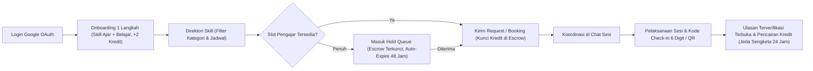
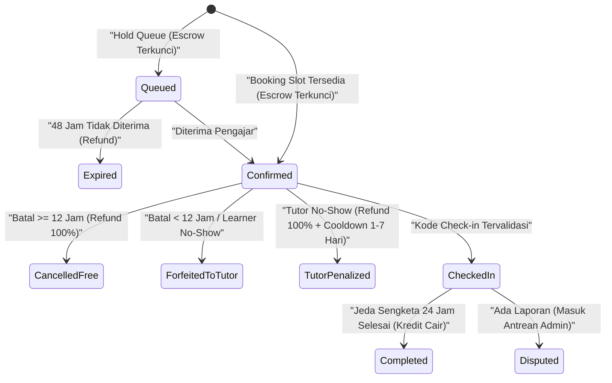
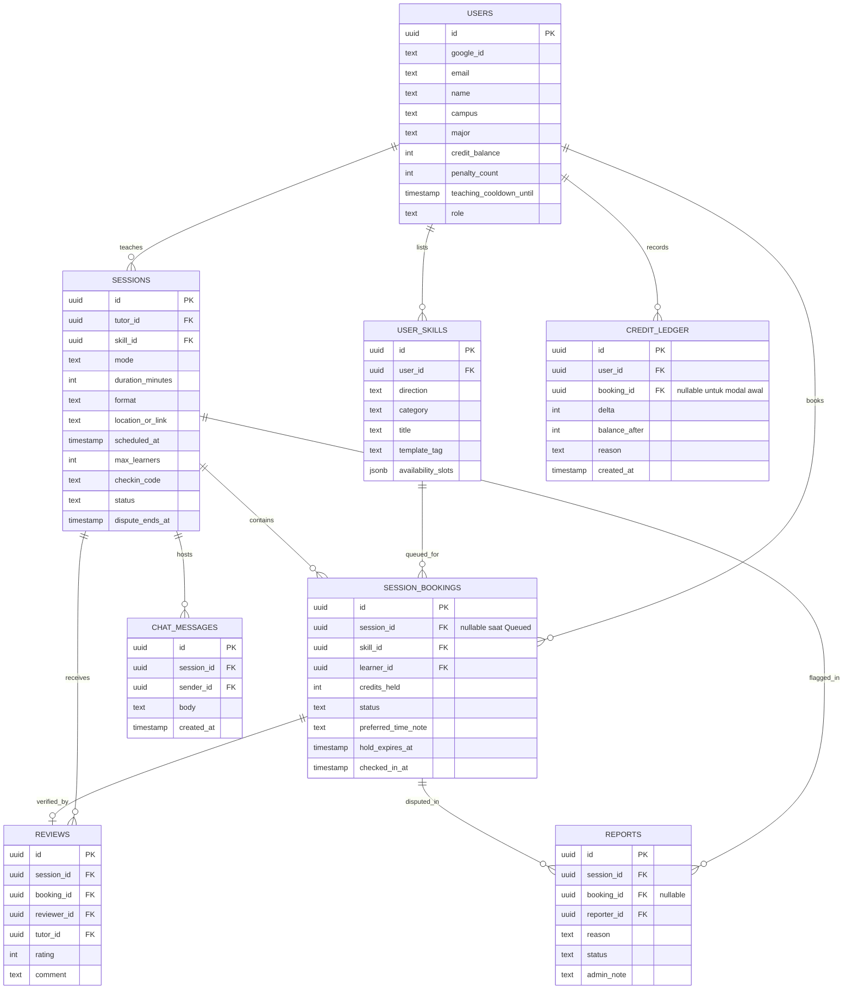

# Product Requirements Document (PRD): SkillBarter MVP

> **Learning Without Money, Teaching for Credits**  
> Dokumen ini merangkum spesifikasi produk dan kebutuhan teknis MVP **SkillBarter** untuk **Case 1: Smarter Campus and Learning** berdasarkan abstrak tim **pecut agen** serta keputusan desain yang telah disepakati.

---

## 1. Ringkasan Eksekutif & Konteks Kompetisi

| Atribut | Detail |
| :--- | :--- |
| **Nama Produk** | SkillBarter: Learning Without Money, Teaching for Credits |
| **Tim** | pecut agen — Teofilus Tri Adinugraha Moelyono (Leader), Archyeza Gaciyama Feodora, Cynthia Elena Gunadi, Efraim Bias Adisya |
| **Kasus Kompetisi** | Case 1: Smarter Campus and Learning |
| **Skor Awal & Catatan Juri** | **86.0 / 100** (Judge 13) — P2 & P5 sudah 5/5; P1, P3, dan P4 masih 4/5 dengan catatan bahwa *"konsep skill barter bukan hal baru"*, sementara **ulasan terverifikasi** menjadi pembeda kuat dibanding grup media sosial. |
| **Target Tahap Ini** | Membangun **MVP web app yang siap diuji dan didemokan** lengkap dengan alur ekonomi kredit yang anti-eksploitasi, verifikasi kehadiran, dan metrik evaluasi uji coba. |

### Masalah & Bukti Survei (30 Mahasiswa)
1. **Kebutuhan belajar lintas bidang tinggi:** Rata-rata **4,3 / 5**.
2. **Kesulitan mencari teman yang bisa mengajari:** Rata-rata **3,4 / 5**.
3. **Kesenjangan kesiapan mengajar:** Dari 30 responden, hanya **6** yang bersedia mengajar tanpa syarat, sedangkan **17 ragu-ragu** dan **6 bersedia bersyarat**.

> [!IMPORTANT]
> Karena 23 dari 30 responden masih ragu atau bersyarat untuk mengajar, MVP dirancang khusus untuk menurunkan beban psikologis pengajar pemula lewat **micro-session 30 menit berbasis template topik**, bukan menuntut sesi kuliah penuh sejak awal.

---

## 2. Target Pengguna (Personas)

1. **Pembelajar (*Learner*):** Mahasiswa yang ingin menguasai skill praktis di luar jurusannya tanpa biaya uang, dengan jaminan kualitas pengajar lewat ulasan terverifikasi.
2. **Pengajar Rekan (*Peer Tutor / Mentor*):** Mahasiswa yang memiliki keterampilan praktis (coding, desain, bahasa, presentasi, dsb.) dan ingin menukar waktu mengajarnya menjadi kredit belajar serta reputasi (*badge*).
3. **Admin / Tim Penyelenggara:** Mengelola laporan pelanggaran perilaku dan memantau metrik evaluasi v1 selama *small user test* dan demo kompetisi.

---

## 3. Arsitektur & Stack Teknologi

| Lapisan | Pilihan Teknologi | Catatan Implementasi |
| :--- | :--- | :--- |
| **Framework Fullstack** | **Nuxt (TypeScript)** | Menangani SSR/CSR UI serta API routes backend dalam satu repositori. |
| **Styling** | **Tailwind CSS v4** | Desain responsif *mobile-first* untuk desktop dan ponsel mahasiswa. |
| **Database** | **PostgreSQL** | Transaksi ACID untuk menjamin integritas saldo kredit dan *escrow*. |
| **ORM** | **Drizzle ORM** | Skema *type-safe* dan transaksi atomik untuk mutasi ledger kredit. |
| **Autentikasi** | **Google OAuth** | Login simpel tanpa OTP; profil memiliki kolom opsional kampus/jurusan. |
| **Pertemuan Sesi** | **Tatap muka / Link eksternal** | Pengguna mengisi titik temu kampus atau link Google Meet / Zoom / Discord (tanpa WebRTC bawaan). |
| **Real-Time Chat** | **Polling ringan (3–5 dtk) / SSE** | Tanpa server WebSocket/Redis terpisah agar *deployment* MVP tetap sederhana. |

---

## 4. Alur Inti Pengguna (*Core User Flow*)

---

## 5. Spesifikasi Fungsional Rinci

### 5.1 Autentikasi & Onboarding 1 Langkah
- **FR-1.1 Login Google OAuth:** Pengguna masuk menggunakan akun Google tanpa verifikasi OTP email.
- **FR-1.2 Onboarding Wajib:** Sebelum mengakses direktori, pengguna baru wajib melengkapi:
  - Minimal **1 skill yang bisa diajarkan** (dapat memilih template topik *micro-session* yang sudah disediakan).
  - Minimal **1 skill yang ingin dipelajari**.
  - Kolom opsional nama kampus dan jurusan.
- **FR-1.3 Saldo Awal:** Akun baru otomatis menerima **2 kredit** sebagai modal awal belajar.

### 5.2 Profil, Listing Skill & Micro-Session
- **FR-2.1 Penawaran Sesi:** Pengajar dapat membuat penawaran skill dengan pilihan:
  - **Durasi:** *Micro-session* **30 menit** (tanya-jawab, *review* tugas/desain, bedah studi kasus) atau sesi standar **60 menit**.
  - **Mode:** **1-on-1** atau **Grup (2–5 pembelajar, khusus 60 menit)**.
  - **Format Pertemuan:** Tatap muka (lokasi kampus) atau Online (tautan Google Meet / Zoom / Discord).
  - **Ketersediaan:** Slot hari dan jam yang dapat difilter pembelajar.
- **FR-2.2 Template Micro-Session:** Sistem menyediakan template topik siap pakai (misalnya *"Code/Portfolio Review 30 Menit"*, *"Q&A Dasar"*, *"Latihan Presentasi"*) untuk membantu pengajar pemula.

### 5.3 Direktori Pencarian, Request & Hold Queue
- **FR-3.1 Direktori Filterable:** Pengguna mencari mentor berdasarkan kategori skill, tipe sesi (1-on-1 / grup), format (online / tatap muka), dan jadwal tersedia. Tanpa AI matchmaking di v1.
- **FR-3.2 Request Langsung:** Pembelajar memilih slot pengajar dan mengirim permintaan sesi. Sistem memverifikasi saldo mencukupi lalu langsung mengunci kredit ke *escrow*.
- **FR-3.3 Hold Queue (Mitigasi Skill Permintaan Tinggi):**
  - Jika slot pengajar sedang penuh, pembelajar dapat masuk ke **Hold Queue** yang menempel pada penawaran skill (`skill_id`, dengan `session_id` masih `NULL` dan catatan preferensi waktu).
  - Kredit pembelajar **langsung dikunci di *escrow*** saat masuk antrean agar antrean hanya berisi peminat serius.
  - Pengajar dapat **Menerima & Menjadwalkan** antrean (membuat slot `SESSIONS` baru lalu menautkan `booking_id`) atau **Menolak** (kredit langsung *refund*).
  - Jika tidak diterima pengajar dalam **48 jam**, permintaan otomatis kedaluwarsa (*expired*) dan kredit dikembalikan ke saldo pembelajar.

### 5.4 Ekonomi Kredit (Bilangan Bulat & Anti-Minus)
Seluruh kredit menggunakan **bilangan bulat (`1, 2, 3, ...`)** dan saldo **tidak pernah boleh kurang dari `0`**.

| Jenis Sesi | Durasi | Biaya Pembelajar | Pendapatan Pengajar | Catatan Ekonomi |
| :--- | :--- | :--- | :--- | :--- |
| **1-on-1 (Micro / Standar)** | 30 atau 60 menit | `1` kredit | `1` kredit | Pertukaran 1:1 bersih. |
| **Grup (2–5 Pembelajar)** | 60 menit | `1` kredit / orang | Flat maksimal **`2` kredit** | Kuorum minimal **2 pembelajar** pada `T - 2 jam`. Total kredit masuk selalu $\ge 2$, mencegah inflasi kredit. |

- **FR-4.1 Kuorum Sesi Grup:** Jika hingga **2 jam sebelum sesi dimulai (`T - 2 jam`)** jumlah pembelajar terkonfirmasi kurang dari **2 orang**, sesi grup otomatis dibatalkan dan seluruh kredit *escrow* dikembalikan ke pembelajar.
- **FR-4.2 Transaksi Atomik:** Pemotongan saldo, penguncian *escrow*, pencairan, dan *refund* wajib berjalan di dalam transaksi database PostgreSQL dengan penguncian baris agar tidak terjadi *double-spend* atau saldo negatif.
- **FR-4.3 Pelacakan Parsial Sesi Grup:** Kehadiran (`checked_in_at`), ulasan, dan sengketa dilacak per `booking_id`. Pembelajar yang check-in dapat memberi ulasan dan masuk jeda sengketa 24 jam; pembelajar yang *no-show* hangus `1` kreditnya; total pendapatan pengajar tetap dibatasi maksimal `2` kredit per sesi grup. Sengketa pada satu `booking_id` tidak menahan pencairan peserta lain yang sah.

### 5.5 Verifikasi Kehadiran, Ulasan Terverifikasi & Badge
- **FR-5.1 Check-in 6 Digit / QR:** Pengajar dapat membuat **kode check-in 6 digit (beserta QR)** di halaman sesi mulai **`T - 10 menit`** hingga **`T + 15 menit`** dari `scheduled_at`. Pembelajar memasukkan kode tersebut untuk mencatat kehadiran terverifikasi.
- **FR-5.2 Ulasan Terverifikasi (*Attendance-Gated*):** Fitur pemberian rating (1–5) dan ulasan teks **hanya terbuka** setelah kehadiran tercatat.
- **FR-5.3 Pencairan Escrow & Jeda Sengketa:** Setelah check-in sukses, pencairan kredit ke pengajar menunggu **jeda sengketa 24 jam** (atau langsung cair jika tidak ada laporan pelanggaran dalam 24 jam).
- **FR-5.4 Badge "Verified Peer Mentor":** Diberikan otomatis kepada pengajar yang memenuhi ketiga syarat berikut:
  - Menyelesaikan **$\ge 3$ sesi mengajar**.
  - Rating rata-rata **$\ge 4,5 / 5,0$**.
  - Memiliki **0 penalti aktif**.

### 5.6 Pembatalan, No-Show & Penalti Cooldown

- **FR-6.1 Batal Gratis ($\ge 12$ jam):** Pembelajar atau pengajar membatalkan minimal 12 jam sebelum jadwal mulai $\rightarrow$ kredit *escrow* dikembalikan 100% tanpa penalti.
- **FR-6.2 Batal Terlambat / Learner No-Show ($< 12$ jam atau tidak check-in dalam 15 menit):** Kredit *escrow* pembelajar hangus dan diserahkan ke pengajar sebagai kompensasi waktu.
- **FR-6.3 Tutor No-Show (Penalti Cooldown, Bukan Saldo Minus):**
  - **Deteksi:** Jika lewat **`15 menit`** dari `scheduled_at` pengajar belum membuat `checkin_code`, *lazy-check* otomatis memicu `TutorPenalized`. Jika kode sempat dibuat tetapi pengajar tidak hadir, pembelajar dapat mengajukan laporan sengketa manual ke Admin.
  - Kredit *escrow* pembelajar dikembalikan 100%.
  - Pengajar dikenai **masa jeda (*cooldown*) tidak dapat membuat atau menerima sesi mengajar** berdasarkan `penalty_count`:
    - Pelanggaran ke-1: **1 hari (24 jam)**.
    - Pelanggaran ke-2: **3 hari**.
    - Pelanggaran ke-3 dan seterusnya: **7 hari** (maksimal), termasuk jika saldo pengajar `0`.

### 5.7 Fitur Chatting Terikat Sesi
- **FR-7.1 Ruang Chat Otomatis:** Setiap sesi yang berstatus `Confirmed` (1-on-1 maupun grup) otomatis memiliki satu ruang chat khusus untuk peserta sesi tersebut. Tidak ada DM bebas di luar konteks sesi maupun sebelum permintaan `Queued` disetujui untuk mencegah *spam*.
- **FR-7.2 Konten Chat:** Mendukung pesan teks dan pendeteksian tautan otomatis (untuk membagikan link Google Meet/Zoom, lokasi kampus, atau referensi belajar). Upload file/gambar tidak disertakan di MVP.
- **FR-7.3 Sinkronisasi Pesan:** Menggunakan *polling* ringan (interval 3–5 detik saat halaman chat aktif) atau SSE ke endpoint Nuxt.

### 5.8 Admin, Metrik Evaluasi v1 & Alat Demo
- **FR-8.1 Antrean Laporan & Sengketa:** Admin (ditentukan langsung melalui kolom `USERS.role = 'admin'` di database atau *seed data*) dapat meninjau laporan pelanggaran perilaku atau sengketa sesi per `booking_id` dalam jeda 24 jam, lalu memutuskan *refund* ke pembelajar, pencairan ke pengajar, atau penalti *cooldown*.
- **FR-8.2 Dashboard Metrik Evaluasi:** Menampilkan dan mengekspor (CSV/JSON) metrik evaluasi dari abstrak:
  - Jumlah sesi selesai (1-on-1 vs grup, 30 menit vs 60 menit).
  - Total perputaran kredit (masuk *escrow*, cair, *refund*, kedaluwarsa).
  - Rekap ulasan, rating rata-rata, dan umpan balik peserta uji coba.
- **FR-8.3 Simulasi Waktu Demo Juri:** Dashboard Admin menyediakan kontrol simulasi (*fast-forward*) untuk mempercepat evaluasi jeda sengketa 24 jam, kedaluwarsa *Hold Queue* 48 jam, dan batas kuorum `T - 2 jam` pada data uji coba saat demo langsung.

---

## 6. Model Data Konseptual (PostgreSQL + Drizzle ORM)

---

## 7. Non-Functional Requirements & Batasan MVP

### Kebutuhan Non-Fungsional
1. **Integritas Data Kredit:** Setiap perubahan `credit_balance` wajib dicatat di `credit_ledger` dalam satu transaksi DB atomik dengan `CHECK (credit_balance >= 0)`.
2. **Responsivitas UI:** Seluruh alur inti (direktori, booking, QR check-in, dan chat) nyaman dipakai pada layar ponsel maupun desktop.
3. **Otomasi Berbasis Waktu:** Status kedaluwarsa *hold queue* (`48 jam`), pembatalan kuorum grup (`T - 2 jam`), dan pencairan pasca-sengketa (`24 jam`) ditangani lewat pengecekan terjadwal atau evaluasi *lazy-check* saat *request* API agar reliabel di MVP.

### Di Luar Ruang Lingkup (*Out of Scope* v1)
- Pencocokan berbasis AI / ML (*AI matching*).
- Verifikasi OTP email / pembatasan paksa domain `.ac.id`.
- *Video/audio call* bawaan (WebRTC).
- Upload file/gambar di ruang chat.
- Pembayaran atau penarikan uang nyata (*fiat*).

---

## 8. Rencana Tahapan Pengembangan & Kriteria Selesai

| Fase | Fokus Pekerjaan | Kriteria Selesai (*Definition of Done*) |
| :--- | :--- | :--- |
| **Fase 1: Fondasi** | Setup Nuxt (TS), Tailwind v4, PostgreSQL, Drizzle schema, Google OAuth, Onboarding 1 langkah, saldo awal `2` kredit. | Pengguna bisa login Google, mengisi skill ajar/belajar, dan melihat saldo `2` kredit di profil. |
| **Fase 2: Direktori & Escrow** | Listing skill/micro-session, filter direktori, booking 1-on-1 & grup, *hold queue* 48 jam, transaksi *escrow* atomik. | Kredit terkunci saat request/queue, batal $\ge 12$ jam refund penuh, kuorum grup `< 2` di `T - 2 jam` auto-batal. |
| **Fase 3: Sesi, Trust & Chat** | Chat per sesi (polling/SSE), kode check-in 6 digit/QR, ulasan terverifikasi, badge *Verified Peer Mentor*, penalti *cooldown* 1–7 hari. | Pembelajar hanya bisa mengulas setelah check-in; tutor *no-show* otomatis kena *cooldown* mengajar. |
| **Fase 4: Evaluasi & User Test** | Dashboard admin (resolusi laporan + ekspor metrik v1), *seeding* data demo, serta *small user test*. | Tim bisa mendemokan seluruh alur ujung-ke-ujung dan mengekspor metrik untuk presentasi juri. |
